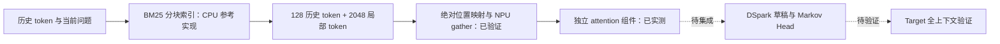

# DSpark 历史 KV 优化：实现、实测与证据边界

2026-10-17。本目录记录从简历中的研究设想出发，实际完成的第一阶段实验。入口按“问题 → 实现 → 正确性 → 性能 → Profiling → 下一步”组织，所有图表均由提交的原始数据生成。

**已完成的是历史锚点选择、绝对地址映射参考实现，以及真实 Ascend NPU 上的 KV 读取与 attention 组件实验。完整 DSpark 服务集成和端到端复现尚未完成。** 简历里的吞吐、TPOT、接受长度和 Draft Attention 数字均未当成实测结果使用。

## 1. 研究问题

草稿模型是否需要读取全部历史 KV？如果只保留局部窗口，会不会漏掉回答问题需要的远距离信息？增加历史锚点后，其信息收益能否覆盖检索、索引准备和非连续 KV 读取的成本？

已有框架的草稿 KV 滑窗作为基线使用。历史锚点的模型质量收益、接受率收益和端到端速度收益目前仍是待检验假设，不能由随机 KV 组件实验推导出来。



## 2. 已实现的选择策略

[history_policy.py](history_policy.py) 按 128-token 块建立 token-ID BM25 索引，使用当前问题的 token ID 排序历史块，选取一个完整历史块，再拼接最近 2048 个 token。历史块与局部窗口不重叠，位置按时间顺序排列。

`physical_addresses` 保留绝对位置对应的物理页和页内偏移。它没有把不对齐的 token 集合冒充可直接送入 FIA 的块表。短序列、尾块、重复位置、不同 kernel page 大小及增长的上下文都有测试。


这张图是位置示意，不是性能测量。实际框架接入约束见 [integration.md](integration.md)。

## 3. 真实实验环境与测量范围

| 项目 | 本次记录 |
| --- | --- |
| NPU 运行时型号 | `Ascend910_9362`，可见 2 个设备，每个 64GB；实验使用逻辑设备 0 |
| 系统 | Linux aarch64，glibc 2.31，Python 3.11.4 |
| 软件 | CANN 9.0.0；PyTorch 2.7.1+cpu；torch-npu 2.7.1.post4 |
| vLLM / vLLM-Ascend / Transformers | 当前服务器未安装 |
| 模型权重 | 检查的常见缓存目录中未找到 Qwen3 / DSpark 权重 |
| 数据与形状 | 合成 BF16 Q/K/V；batch 1/4；历史 4096/16384/24576；8 个 query、8 头、head dimension 128 |
| 统计 | 两轮独立进程，每路径每形状 3 次预热、30 次测量；共 1440 个计时样本 |

完整快照见 [environment.json](evidence/environment.json)。这里的 8 头、8 query 等是组件参数，未从已加载的 DSpark 模型提取。`+cpu` 是底层 PyTorch 包标识；实际计算使用 `torch_npu` 和 NPU。

[benchmark_attention.py](benchmark_attention.py) 使用未融合的 `matmul → FP32 softmax → BF16 matmul`，只计算已经缓存的历史位置，无因果 mask。它不是 vLLM 的实际 FIA kernel，也不包含模型权重、草稿 backbone、Markov Head、Target Verification、KV 写入或服务调度。

四条路径读取同一份合成 KV：Full KV；2176-token 连续窗口；在线 BM25 排序的历史锚点；缓存历史锚点。缓存版仍在**每次调用**重建局部窗口索引、拼接索引并 gather K/V，没有把整个滑动窗口永久冻结。请求级 BM25 索引构建在计时之外；在线路径的排序和索引传输在计时之内。

每次计时前后同步 NPU，路径顺序在每轮中随机化。图中阴影为样本 P10-P90，不是置信区间，也不代表跨机器统计。

## 4. 正确性与真实性能

两轮共 48 组 NPU 输出均通过各自读取集合的 CPU FP32 参考检查，`atol=0.02, rtol=0.02`，最大绝对误差为 **0.001936**。该容差仅用于组件检查。Full KV 与稀疏 KV 的输出本来可能不同；这里没有证明模型生成质量或接受率相同。


下表是两轮共 60 个样本合并后的中位数，单位 ms。每轮单独统计和全部样本保留在 [summary.csv](summary.csv)、[run_06.json](evidence/run_06.json)、[run_07.json](evidence/run_07.json)。

| Batch | 历史长度 | Full KV | 连续窗口 | 在线历史锚点 | 缓存锚点，含窗口索引准备 |
| --- | --- | --- | --- | --- | --- |
| 1 | 4K | 0.144 | 0.175 | 0.493 | 0.205 |
| 1 | 16K | 0.201 | 0.207 | 0.675 | 0.247 |
| 1 | 24K | 0.226 | 0.193 | 0.729 | 0.240 |
| 4 | 4K | 0.174 | 0.213 | 0.581 | 0.328 |
| 4 | 16K | 0.509 | 0.220 | 0.698 | 0.319 |
| 4 | 24K | 0.717 | 0.211 | 0.776 | 0.317 |

**观察 1：检索缓存值得做，但仍没有超过连续窗口。** Batch 4、24K 时，从在线检索改为缓存历史锚点，组件中位数降低约 59.2%；缓存版仍比连续窗口慢约 50.5%。这两个百分比描述本组件，不能替换成模型吞吐提升。


**观察 2：短上下文存在回退。** Batch 4、4K 时，Full KV 比另外三条路径更快。不能只展示长上下文结果并宣称稀疏化普遍有效。

**观察 3：Batch 1 的细小收益不稳定。** 24K 下，run_06 的缓存路径为 0.272 ms，Full KV 为 0.239 ms；run_07 则分别为 0.197 和 0.221 ms，方向发生变化。当前证据不支持 Batch 1 稳定提速的结论。Batch 4、24K 下缓存路径的两轮中位数为 0.319 / 0.315 ms，趋势更稳定。

## 5. Profiling：剩余成本在哪里


这张图来自独立的 CPU/NPU Profiling 迭代，不混入上面的性能样本。灰色条是包含同步等待的 host 作用域，不是 CPU 利用率。彩色条是 `Ascend Hardware` 的真实 kernel 事件。

缓存路径仍有两次 `IndexSelect/Gather`，该次 trace 中合计约 **145.3 μs**。因此移除在线排序之后，非连续 K/V 的物化搬运仍然存在。连续窗口也有实际的 slice/布局处理，不能假设它的准备成本为零。

Profiling 会改变执行成本，不能用 trace 的 kernel 时间直接减去无 Profiler 的计时中位数。此次未采集 AI Core 性能计数器，不据此推断峰值带宽或计算利用率。

可审阅 [profile_summary.json](profile_summary.json)，或解压 [原始 trace](evidence/run_06.trace.json.gz) 后用 Chrome trace / Perfetto 查看。导出保留原始文件 SHA-256。

## 6. 复现

进入本目录，先运行不依赖模型、torch 或 NPU 的语义测试：

```bash
python -m unittest discover -s . -p 'test_*.py' -v
```

在已配置好的 NPU 环境串行运行，不与其他 NPU 基准并发：

```bash
bash run_npu.sh /path/to/CANN/set_env.sh --output evidence/repeat_a.json --profile
bash run_npu.sh /path/to/CANN/set_env.sh --output evidence/repeat_b.json
```

只重建已提交的图表无需 NPU；绘图依赖见 [requirements-plots.txt](requirements-plots.txt)：

```bash
python plot_results.py evidence/run_06.json evidence/run_07.json --output figures
python plot_profile.py evidence/run_06.trace.json.gz --output figures
```

绘图入口检查两轮的源码 hash、环境、配置、样本数量、数值检查和完整形状矩阵，不接受失败结果或把端到端数据混画为组件结果。

## 7. 仍待完成的完整项目

| 项目 | 状态 |
| --- | --- |
| 历史锚点 CPU 选择与绝对地址参考 | 已实现并测试 |
| NPU 组件性能、重复测量、索引缓存消融与时间线 | 已完成 |
| AR / Full KV / Window 的 vLLM 基线入口 | 已准备；仅配置和指标逻辑经过测试，尚未在真实模型上运行 |
| 历史锚点接入 DSpark 的实际 attention metadata / FIA | 尚未完成 |
| Mean acceptance length、TPOT、端到端吞吐、生成一致性 | 尚未实测 |
| 简历中的性能数字 | 未验证，不作为成果引用 |

下一步需要准备与 DSpark 版本匹配的完整推理环境及 Qwen3-8B / DSpark Block-7 权重。当前可达服务器是 CANN 9.0 的算子环境，缺少推理栈，也没有 Docker/Podman。已核查的旧版本与当前 DSpark 源码不是同一套兼容组合，不能直接混装后声称复现成功。具体接入检查与基线命令见 [integration.md](integration.md)。

来源核对、候选变化与失败尝试见 [experiments.md](experiments.md)。本目录仅新增独立研究材料，未修改生产模型路径。
