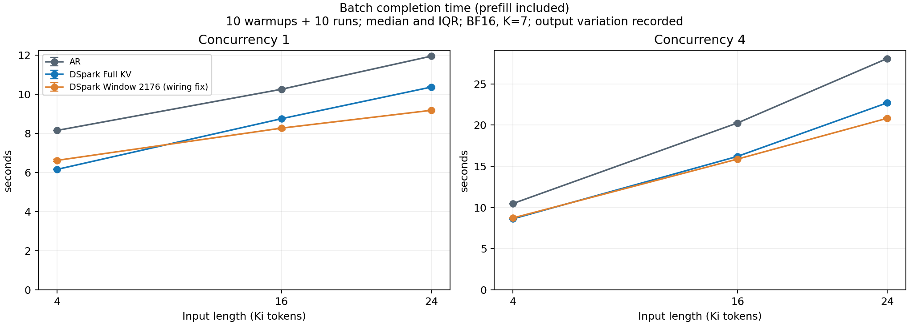
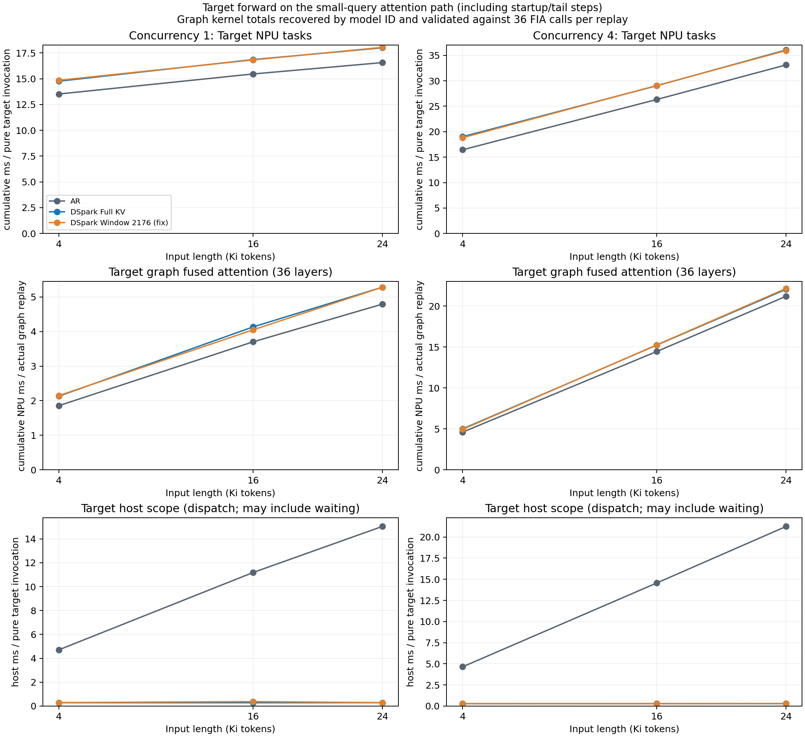
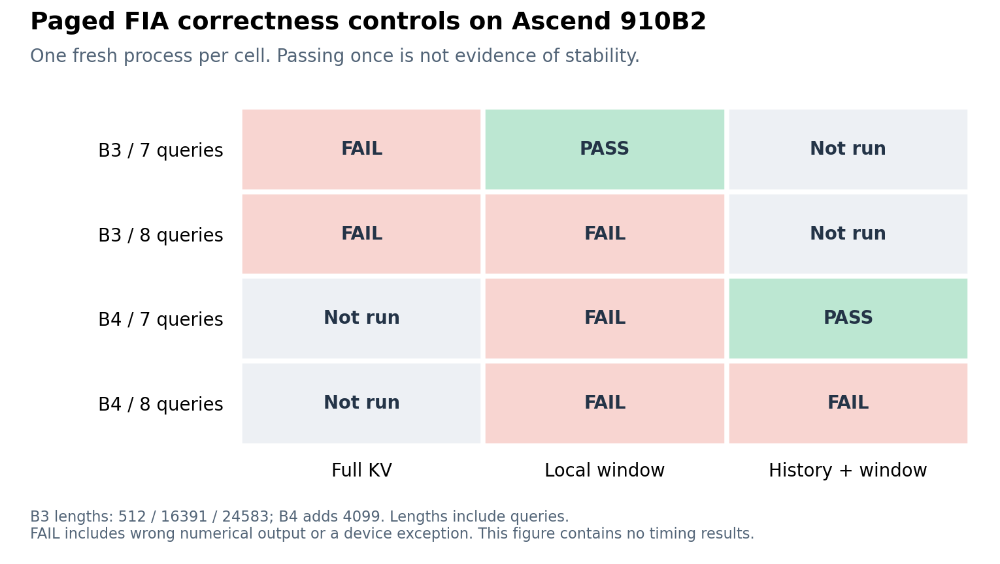
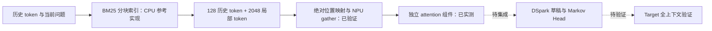
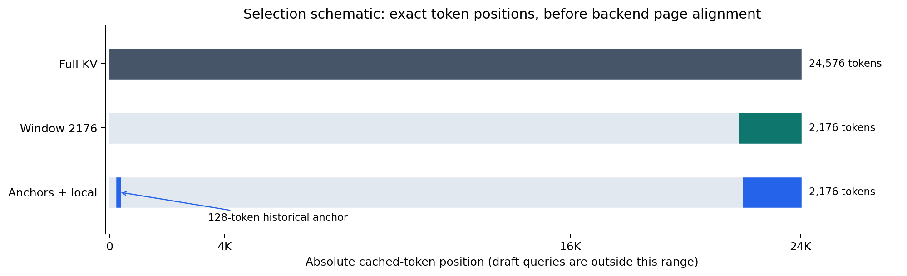
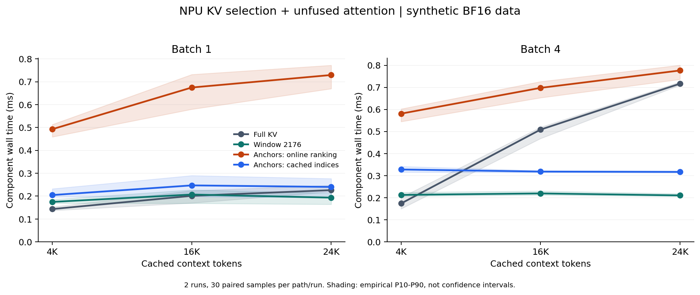
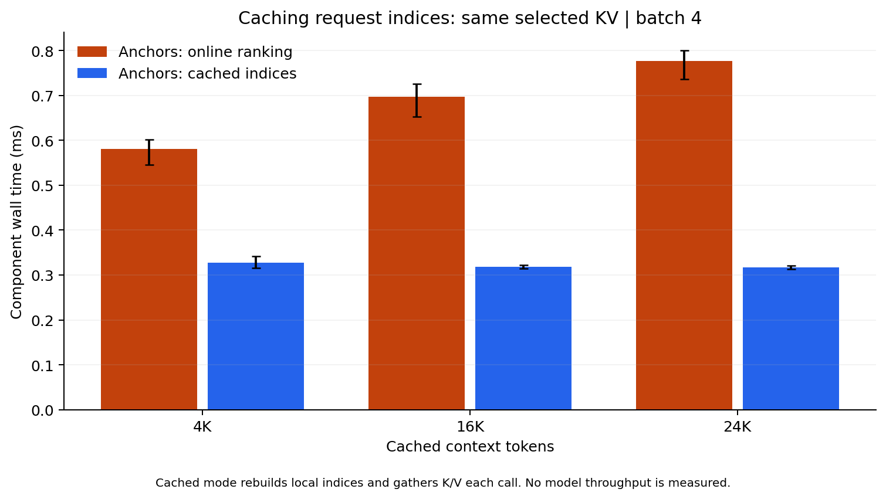
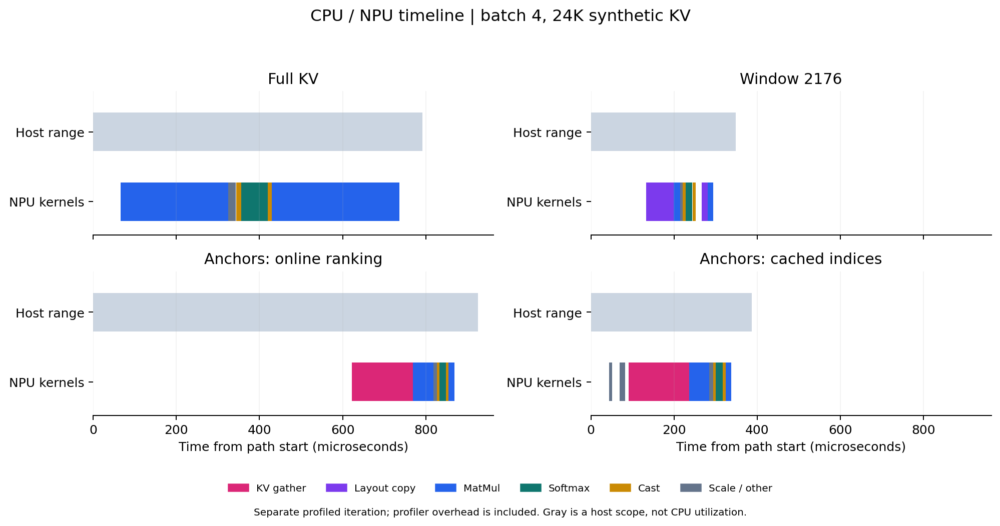

# 长上下文投机解码：历史 KV、瓶颈分析与实验记录

更新：2026-10-18。本目录记录从简历中的设想出发，持续实施的长上下文投机解码研究。入口按“问题 → 实现 → 正确性 → 性能 → Profiling → 下一步”组织。简历数字不是优化目标，也不作为实验结果；没有收益或验证失败的候选同样保留。

**已完成 AR、原生 DSpark Full KV、最小接线修正后的 Draft Window 三组正式对比和阶段 profiling。** 输入 4K / 16K / 24K，输出固定 512 token，并发 1 与 4 分开，BF16，投机组 K=7。18 个配置、180 批正式测量、450 次请求；另有 18 份独立采集和 12 份读取审计。

[完整实验与瓶颈报告](context_baseline_results.md) · [性能表](results/context_20261018/context_tables.md) · [阶段表](results/context_20261018/context_profile_tables.md) · [全部输出变体](results/context_20261018/context_outputs.md) · [复算说明](context_reproduction.md)



长上下文并发 4 的主要设备增长项是 Target attention。窗口降低了 Draft attention 成本，
但没有改变 Target 的完整上下文验证；4K 的接受长度下降还导致窗口回退。
部分输出与 AR 不一致，图中的耗时比按真实观察展示，不能统一称为已验证的无损加速。



原生窗口曾存在实际读表接线错误，已在独立副本中做最小修正并通过读取审计；
接线、调度预算、计时入口和图归因的核验过程见 [实际发现](context_baseline_findings.md)。
541 个封存文件均经原始/展开 SHA-256 校验，完整 CSV 在本地独立复算后与服务器汇总一致。
条件见 [正式协议](baseline_bottleneck_protocol.md)。

## 早期探索与运行门槛记录

下文保留组件实验和历史 KV 原型，环境与本轮模型矩阵分开；历史选择本轮未启用。
原始运行故障后来未再复现，根因仍未确认，见 [限时排查](bounded_diagnosis.md)。

当前进展：

| 阶段 | 实际证据与状态 |
| --- | --- |
| 正式模型基线与阶段 profiling | 已完成 18 配置、180 批、18 份独立采集；[主报告](context_baseline_results.md) |
| 组件性能与时间线 | 两轮、1440 个计时样本和 4 类图表，见下文 |
| 新服务器推理准备 | 910B2、64GB；4×4 矩阵冒烟检查通过；Target 16 个文件和 Draft 5 个文件逐一校验，见 [环境](evidence/server_b2/runtime_probe.json)、[Target](evidence/server_b2/target_verified.json)、[Draft](evidence/server_b2/model_download.json) |
| 历史页＋局部窗口 | [paged_history.py](paged_history.py) 实现整页直读、请求级缓存及 BM25 / uniform / sink / recent 对照；10 项逻辑测试通过 |
| 实际 DSpark builder 接线 | 双 KV group、混合长度的 10 组 CPU 回归通过，见 [原始结果](evidence/server_b2/history_builder_qa.json)；补丁尚未晋升为模型验证通过 |
| 真实分页 FIA | 首轮 8 组通过，第 9 组失败；保留 [全部结果](evidence/server_b2/paged_fia_initial.json) 和匹配 SHA-256 的 [当时源码](archive/fia_initial/validate_paged_history_npu.py) |
| 原生运行门槛 | 最初 AR 失败、DSpark 成功；随后默认队列、新缓存及固定次数检查均通过，累计 13 次启动、58 份原生 512-token 测量输出一致；[单输入图与完整记录](bounded_diagnosis.md)。这项短输入诊断不替代正式长度矩阵，也不证明长输入跨方法输出一致 |
| 最小问题隔离 | 此前确有整数算子周期错误、官方 A2 错误及向量检查 97/3200 失败；本轮 metadata 360 次和向量 3200 次复测均通过。旧结果与图保留于 [分阶段分析](environment_diagnostics.md)，最新状态见 [限时排查](bounded_diagnosis.md) |

当前研究取舍、公式和论文参考见 [research_notes.md](research_notes.md)；部署与回归入口见 [integration.md](integration.md)；失败、修正和下一步见 [experiments.md](experiments.md)。不同设备、运行库和执行模式的结果分开记录。



这张图保留首批独立进程对照的全部 8 个结果。红色包括数值错误和设备异常，灰色为未测；单次绿色不证明稳定。完整 KV 对照也出现失败，因此目前不能将异常归因于历史选择。输入、错误与 SHA-256 见 [汇总](backend_validation_summary.json)，可用 `plot_backend_validation.py` 从全部原始 JSON 重新生成。

## 1. 研究问题

草稿模型是否需要读取全部历史 KV？如果只保留局部窗口，会不会漏掉回答问题需要的远距离信息？增加历史锚点后，其信息收益能否覆盖检索、索引准备和非连续 KV 读取的成本？

已有框架的草稿 KV 滑窗作为基线使用。历史锚点的模型质量收益、接受率收益和端到端速度收益目前仍是待检验假设，不能由随机 KV 组件实验推导出来。



## 2. 已实现的选择策略

[history_policy.py](history_policy.py) 按 128-token 块建立 token-ID BM25 索引，使用当前问题的 token ID 排序历史块，选取一个完整历史块，再拼接最近 2048 个 token。历史块与局部窗口不重叠，位置按时间顺序排列。

`physical_addresses` 保留绝对位置对应的物理页和页内偏移。它没有把不对齐的 token 集合冒充可直接送入 FIA 的块表。短序列、尾块、重复位置、不同 kernel page 大小及增长的上下文都有测试。



这张图是位置示意，不是性能测量。实际框架接入约束见 [integration.md](integration.md)。

## 3. 早期组件实验环境与测量范围

| 项目 | 2026-10-17 组件阶段记录（与本轮 910B2 模型矩阵分开） |
| --- | --- |
| NPU 运行时型号 | `Ascend910_9362`，可见 2 个设备，每个 64GB；实验使用逻辑设备 0 |
| 系统 | Linux aarch64，glibc 2.31，Python 3.11.4 |
| 软件 | CANN 9.0.0；PyTorch 2.7.1+cpu；torch-npu 2.7.1.post4 |
| vLLM / vLLM-Ascend / Transformers | 此组件测量阶段未安装；后续模型环境另见上方进展 |
| 模型权重 | 此组件测量未加载任何模型权重 |
| 数据与形状 | 合成 BF16 Q/K/V；batch 1/4；历史 4096/16384/24576；8 个 query、8 头、head dimension 128 |
| 统计 | 两轮独立进程，每路径每形状 3 次预热、30 次测量；共 1440 个计时样本 |

完整快照见 [environment.json](evidence/environment.json)。这里的 8 头、8 query 等是组件参数，未从已加载的 DSpark 模型提取。`+cpu` 是底层 PyTorch 包标识；实际计算使用 `torch_npu` 和 NPU。

[benchmark_attention.py](benchmark_attention.py) 使用未融合的 `matmul → FP32 softmax → BF16 matmul`，只计算已经缓存的历史位置，无因果 mask。它不是 vLLM 的实际 FIA kernel，也不包含模型权重、草稿 backbone、Markov Head、Target Verification、KV 写入或服务调度。

四条路径读取同一份合成 KV：Full KV；2176-token 连续窗口；在线 BM25 排序的历史锚点；缓存历史锚点。缓存版仍在**每次调用**重建局部窗口索引、拼接索引并 gather K/V，没有把整个滑动窗口永久冻结。请求级 BM25 索引构建在计时之外；在线路径的排序和索引传输在计时之内。

每次计时前后同步 NPU，路径顺序在每轮中随机化。图中阴影为样本 P10-P90，不是置信区间，也不代表跨机器统计。

## 4. 正确性与真实性能

两轮共 48 组 NPU 输出均通过各自读取集合的 CPU FP32 参考检查，`atol=0.02, rtol=0.02`，最大绝对误差为 **0.001936**。该容差仅用于组件检查。Full KV 与稀疏 KV 的输出本来可能不同；这里没有证明模型生成质量或接受率相同。



下表是两轮共 60 个样本合并后的中位数，单位 ms。每轮单独统计和全部样本保留在 [summary.csv](summary.csv)、[run_06.json](evidence/run_06.json)、[run_07.json](evidence/run_07.json)。

| Batch | 历史长度 | Full KV | 连续窗口 | 在线历史锚点 | 缓存锚点，含窗口索引准备 |
| --- | --- | --- | --- | --- | --- |
| 1 | 4K | 0.144 | 0.175 | 0.493 | 0.205 |
| 1 | 16K | 0.201 | 0.207 | 0.675 | 0.247 |
| 1 | 24K | 0.226 | 0.193 | 0.729 | 0.240 |
| 4 | 4K | 0.174 | 0.213 | 0.581 | 0.328 |
| 4 | 16K | 0.509 | 0.220 | 0.698 | 0.319 |
| 4 | 24K | 0.717 | 0.211 | 0.776 | 0.317 |

**观察 1：检索缓存值得做，但仍没有超过连续窗口。** Batch 4、24K 时，从在线检索改为缓存历史锚点，组件中位数降低约 59.2%；缓存版仍比连续窗口慢约 50.5%。这两个百分比描述本组件，不能替换成模型吞吐提升。



**观察 2：短上下文存在回退。** Batch 4、4K 时，Full KV 比另外三条路径更快。不能只展示长上下文结果并宣称稀疏化普遍有效。

**观察 3：Batch 1 的细小收益不稳定。** 24K 下，run_06 的缓存路径为 0.272 ms，Full KV 为 0.239 ms；run_07 则分别为 0.197 和 0.221 ms，方向发生变化。当前证据不支持 Batch 1 稳定提速的结论。Batch 4、24K 下缓存路径的两轮中位数为 0.319 / 0.315 ms，趋势更稳定。

## 5. Profiling：剩余成本在哪里



这张图来自独立的 CPU/NPU Profiling 迭代，不混入上面的性能样本。灰色条是包含同步等待的 host 作用域，不是 CPU 利用率。彩色条是 `Ascend Hardware` 的真实 kernel 事件。

缓存路径仍有两次 `IndexSelect/Gather`，该次 trace 中合计约 **145.3 μs**。因此移除在线排序之后，非连续 K/V 的物化搬运仍然存在。连续窗口也有实际的 slice/布局处理，不能假设它的准备成本为零。

Profiling 会改变执行成本，不能用 trace 的 kernel 时间直接减去无 Profiler 的计时中位数。此次未采集 AI Core 性能计数器，不据此推断峰值带宽或计算利用率。

可审阅 [profile_summary.json](profile_summary.json)，或解压 [原始 trace](evidence/run_06.trace.json.gz) 后用 Chrome trace / Perfetto 查看。导出保留原始文件 SHA-256。

## 6. 复现

进入本目录，先运行不依赖模型、torch 或 NPU 的策略、证据和指标测试：

```bash
python -m unittest test_history_policy test_measurement_contract test_plot_evidence test_emission_timing -v
```

分页适配器的 CPU 测试需要 PyTorch：`python test_paged_history.py -v`。完整分页 FIA 校验需要真实 NPU：`python validate_paged_history_npu.py --output evidence/paged_fia_repeat.json`。验证失败会保存已执行项及错误，不能把未执行项标为通过。

在已配置好的 NPU 环境串行运行，不与其他 NPU 基准并发：

```bash
bash run_npu.sh /path/to/CANN/set_env.sh --output evidence/repeat_a.json --profile
bash run_npu.sh /path/to/CANN/set_env.sh --output evidence/repeat_b.json
```

只重建已提交的图表无需 NPU；绘图依赖见 [requirements-plots.txt](requirements-plots.txt)：

```bash
python plot_results.py evidence/run_06.json evidence/run_07.json --output figures
python plot_profile.py evidence/run_06.trace.json.gz --output figures
```

绘图入口检查两轮的源码 hash、环境、配置、样本数量、数值检查和完整形状矩阵，不接受失败结果或把端到端数据混画为组件结果。

## 7. 仍待完成的完整项目

| 项目 | 状态 |
| --- | --- |
| 历史锚点 CPU 选择与绝对地址参考 | 已实现并测试 |
| NPU 组件性能、重复测量、索引缓存消融与时间线 | 已完成 |
| AR / Full KV / Window / Anchors 的 vLLM 实验入口 | 已实现；正式基线统一使用原生请求统计，旧输出观察入口作为诊断保留 |
| 历史锚点接入 DSpark 的实际 attention metadata / FIA | 适配器和最小隔离补丁已实现；CPU 接线通过，NPU 完整验证未通过 |
| Mean acceptance length、TPOT、端到端吞吐、生成一致性 | 三组长度矩阵、18 份阶段 profiling 与全部输出检查已完成；[实际结果及边界](context_baseline_results.md) |
| 简历中的性能数字 | 未验证，不作为成果引用 |

本轮已完成窗口实际读取校验、18 个配置的正式测量与独立 profiling；1K 保留为运行门槛诊断。
历史选择候选的下一阶段计划见主报告，尚未晋升为模型收益结论。计时、采集和 CPU 解析分阶段串行执行，软件与模型在实验中保持冻结。

研究补丁只允许安装到显式指定的独立运行库副本。原始软件和共享权重保持可追溯，账号密码及权重文件不进入仓库。
