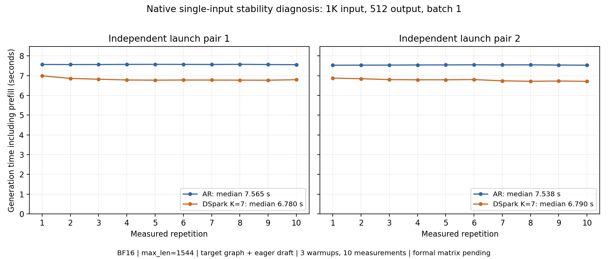

# 原生生成故障：限时排查记录

本轮于 2026-10-18 08:33（北京时间）开始，范围为约一小时的官方资料核对与少量诊断。
实验于 09:18 全部结束，在一小时预算内用约 45 分钟完成；随后整理及校验证据。
不修改模型算法、宿主驱动或固件。原始测量保留，推测另列为假设。
用户已授权：核对官方配套后仍可复现时，用其 GitHub 账号向对应上游提交 Issue。

## 官方资料核对

| 项目 | 官方说明及本机观测 | 判断 |
| --- | --- | --- |
| 硬件系列 | 本机为 Ascend910B2；[官方 FAQ](https://docs.vllm.ai/projects/ascend/en/v0.26.0rc1/faqs.html) 支持 A2 系列 | 不能认定该型号普遍无法运行 |
| 框架与 CANN | Python 3.12.13、Torch 2.10.0、TorchNPU 2.10.0.post4、CANN/NNAL 9.1.0、Triton Ascend 3.2.2，与[发布依赖说明](https://docs.vllm.ai/projects/ascend/en/v0.26.0rc1/user_guide/release_notes.html#dependencies)的主要版本相符 | 不等于全部源码和宿主配套已经验证 |
| vLLM 配对 | 本机为供应镜像的开发源码，插件记录的 verified vLLM commit 与实际 commit 不同；官方要求使用完整兼容集合或对应 verified commit | 仍有配对待核实项，见[安装说明](https://docs.vllm.ai/projects/ascend/en/v0.26.0rc1/installation.html) |
| 模型验证范围 | v0.26.0rc1 发布说明列出有限的完整验证模型，Qwen3-8B 不在该名单；教程同时保留 Qwen3-Dense 配置 | 教程存在不等于该版本已完整验证所有组合 |
| 驱动与固件 | 驱动 25.2.1、固件 7.7.0.9.220；查询返回 Compatibility UNKNOWN，容器缺少 driver/version.info 和 ascend-dmi | UNKNOWN 不是明确不兼容，也不能当作兼容已通过 |
| 任务队列 | [TorchNPU 官方说明](https://www.hiascend.com/document/detail/en/Pytorch/2610/apiref/ENV/docs/en/environment_variable_reference/TASK_QUEUE_ENABLE.md)规定未设置时默认 Level 1；本机独立算子在 0/1/2 下均通过，但图捕获明确拒绝 2 | 显式设 1 后成功，不能单独证明它修复了问题；算子支持不等于图捕获支持 |

`pip check` 还发现 Web 服务和 profiling 等依赖缺失或版本不匹配；当前使用离线生成，
这些冲突本身不能解释独立基础算子的数值错误，也不应直接通过批量升级来尝试修复。
完整快照见 [inventory.json](evidence/server_b2/bounded_diagnosis_20261018/inventory.json)。

## 已观察到的变化

先前原生 AR 的 Python 日志在异步事件同步处报告 507057。
本轮补读同一 worker 的 CANN plog，得到实际故障 kernel：
`GatherV2_7869a97190b9b4d296d9414a005b954b_high_precision_900015015`。
这定位了报告设备异常的算子，但尚未证明索引异常或地址异常的上游根因。
完整 plog 按原始字节压缩保存，见 [索引](evidence/server_b2/bounded_diagnosis_20261018/plog_index.json)。

显式队列 0/1/2 各自执行 1400 次基础算子检查，均通过；随后未设置队列的独立进程也通过。
旧失败记录仍保留，当前不能把恢复全部归因于队列配置，也不能宣称硬件故障已经确认或被修复。

显式队列 1 的原生 AR 已完成两次 512-token 输出，耗时为 7.528376 / 7.528813 秒。
未设置队列的原生 AR 也完成两次输出，耗时为 7.548268 / 7.537140 秒。
这些是运行门槛诊断中的真实结果，包含 prefill，不是正式长度矩阵或 decode TPOT。

失败与成功两次日志中的完整 engine 配置字符串相同。失败时现场编译 npugraph_ex，
后来的成功进程从相同目录加载编译缓存。进一步为每次启动设置全新 `VLLM_CACHE_ROOT`，
三次独立 AR 启动和一次 DSpark K=7 启动均完成两次 512-token 输出。
这不支持“只有使用旧缓存才能成功”的解释，也不证明所有 CANN 缓存因素都已排除。
旧缓存保持原状，没有清除或覆盖。

以上原生检查共有 7 个 AR 进程、2 个 DSpark 进程，各测量 2 次；18 份 512-token 输出完全一致。
固定诊断输入的整数 metadata 复测 360 次、FP32/BF16 向量复测 3200 次均通过。
结论范围仅为这次复测的单一模型输入及列出的算子检查，不能推及全部上下文和并发。

`TASK_QUEUE_ENABLE=2` 的图模式检查在初始化时明确报出“不支持图捕获”，没有生成结果。
诊断进程退出前出现等待，检查 PID、启动 ticks 和进程组后终止本任务的子进程组，
见 [终止记录](evidence/server_b2/bounded_diagnosis_20261018/queue2_interruption.json)。
这是不支持的配置负对照，不是原始 507057 的复现，也不纳入性能样本。

下载证据保留远端 SHA-256 清单；源码快照使用缩短的本地文件名，以避开 Windows 路径长度限制，
原路径映射见 [local_path_map.json](evidence/server_b2/bounded_diagnosis_20261018/local_path_map.json)。
两次独立 queue=2 基础检查写入同一输出文件，但覆盖前备份与最终文件逐字节相同；
各次执行的 spec、起止时间和 stdout 分别保留，不能把共用 JSON 当作两份独立原始文件。

## 固定次数的单输入稳定性检查

预先冻结两轮顺序：AR → DSpark，再 AR → DSpark；每次独立启动预热 3 次、测量 10 次。
使用同一个 1024-token 输入，输出固定 512 token，并发 1，BF16，模型最大长度 1544，
Target 为 FULL_DECODE_ONLY，DSpark 为原生 eager Draft、Full KV、K=7，显式队列 1。
该配置是运行门槛诊断，最大长度与后续正式矩阵的 32768 不同。

| 独立启动 | 有效测量次数 | 含 prefill 耗时中位数 | 最小–最大耗时 |
| --- | --- | --- | --- |
| 第一轮 AR | 10 | 7.564654 秒 | 7.555921–7.573249 秒 |
| 第一轮 DSpark | 10 | 6.779922 秒 | 6.768316–6.991124 秒 |
| 第二轮 AR | 10 | 7.538195 秒 | 7.527845–7.548399 秒 |
| 第二轮 DSpark | 10 | 6.789774 秒 | 6.713101–6.876996 秒 |

两轮新增 40 份测量输出与此前 18 份输出逐 token 一致：累计 13 次原生进程启动、58 份测量输出。
DSpark 的 20 次新增测量均通过 runner 的 AR reference 对照。
每次 DSpark 测量均记录 173 次 draft、1211 个草稿 token、338 个接受 token；
接受率为 338/1211，按 `1 + accepted/drafts` 定义的含 bonus 平均接受长度为 2.953757。
原生 `generate` 接口没有请求级 TTFT / TPOT 事件，相关值保持缺失。

这里看到一个测量层面的问题：预热 3 次后，DSpark 开头的样本仍有耗时下降；
第二轮中后段也出现变化。全部样本保留，不能把删除较慢样本后的结果写成原始测量。
在正式矩阵前需要检查预热与运行波动；现有数据没有阶段时间线，不能据此确定 Attention、
Markov Head、Target verification 或主机等待中的哪一项是瓶颈。

最终 99 份远端归档文件均校验 SHA-256、字节数；压缩日志另校验解压后摘要和字节数。
测量 JSON 会逐轮更新，因此最终清单只在全部作业进入终态后冻结，
先前中途生成的清单已由终态清单替代，避免把中间快照当作完整结果。
原始入口为 [archive_manifest.json](evidence/server_b2/bounded_diagnosis_20261018/archive_manifest.json)，
分析结果为 [derived_native_summary.json](evidence/server_b2/bounded_diagnosis_20261018/derived_native_summary.json)。
图仅使用固定次数检查的全部 40 个样本，其余诊断结果逐进程保留在分析 JSON 中，未合并为性能均值。

复现图与派生汇总：在本目录执行 `python plot_native_recheck.py`。
该入口先核验归档、冻结配置、完整样本、输出一致性及 K=7 接受计数；
数据被改动、输出不完整或配置混用时拒绝生成性能图。

结束时再次核对私有运行库：543 个 `vllm_ascend` 的 Python/共享库文件与原始源码目录逐文件摘要一致，
见 [final_plugin_integrity.json](evidence/server_b2/bounded_diagnosis_20261018/final_plugin_integrity.json)。
设备查询健康为 OK，NPU 上无遗留运行进程，见 [final_hardware.json](evidence/server_b2/bounded_diagnosis_20261018/final_hardware.json)。
单点设备状态不替代利用率 profiling；直接系统环境查询曾因缺少 `libc_sec.so` 失败，
经相同原生启动脚本加载库后查询成功，未归为模型或设备错误。

## 官方 A2 环境交叉复核

使用此前已校验摘要的 `quay.io/ascend/vllm-ascend:v0.26.0rc1` A2 镜像，
镜像摘要为 `sha256:7265a3a08bba26b9376a4d577015ac8d459675fb3c1eec89aef6d9a19ac219d9`。
运行方式为研究目录内的 PRoot，仍共享宿主设备和驱动，不等同于独立宿主或原生 Docker 验证。

四项串行检查均通过：

- 基础算子 1400 次检查。
- 与此前官方环境失败试验相同的 eager、关闭 QK/RoPE 融合、1K 输入 / 32 输出配置，测量 2 次。
- 原生诊断相同的 1K 输入 / 512 输出、Target 图模式 AR，测量 2 次。
- 同条件图模式 DSpark K=7，测量 2 次。

后两项共 4 份 512-token 输出与本轮原生 AR 逐 token 一致；
短输出项使用不同 prompt，两次重复一致，不能与长输出 prompt 混为同一输入比较。
见 [输出对照](evidence/server_b2/bounded_diagnosis_20261018/official_output_comparison.json)。
这些结果用于正确性和能否运行的复核，PRoot 耗时不进入原生性能图。

## Issue 判断

原始 AR 507057 和此前基础算子错误在本轮未再复现，暂不提交故障 Issue。
主要软件版本相符，但源码配对和宿主驱动/固件的完整官方核验仍有缺项；
不能把“当前可运行”或 UNKNOWN 状态写成“全部官方配套已经确认”。
若后续相同冻结配置再次失败，应保留当次 worker plog 和最小重现，再按用户授权提交 Issue。

## 后续正式阶段

- 本轮排查结束，原错误未再复现；不能把这个状态写成“根因已经解决”。
- 用户已授权完成正式三组长度矩阵与阶段 profiling，详见 [基线测试协议](baseline_bottleneck_protocol.md)。
- 正式矩阵和 18 份独立采集现已完成，结果、图和瓶颈分析见 [主报告](context_baseline_results.md)。

诊断数据与后续正式矩阵分开保存；仓库交付已获用户授权。
