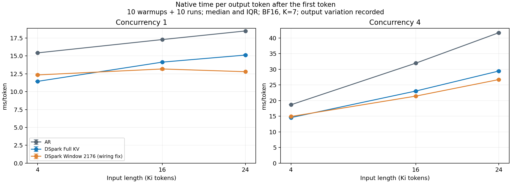
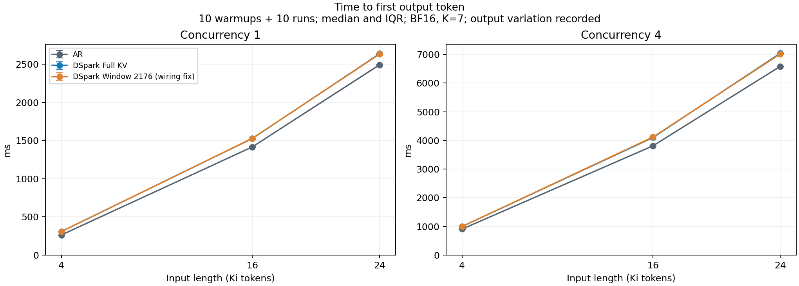
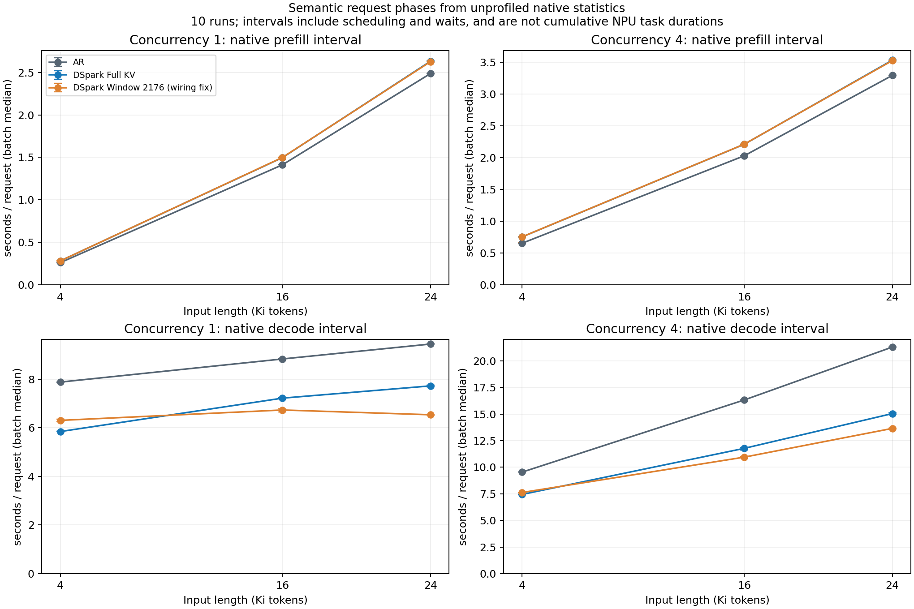
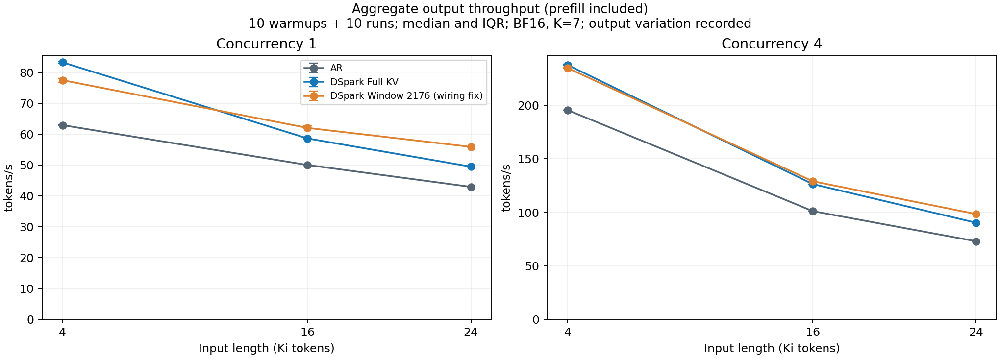
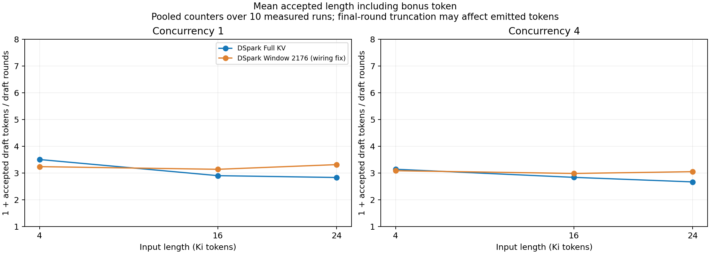
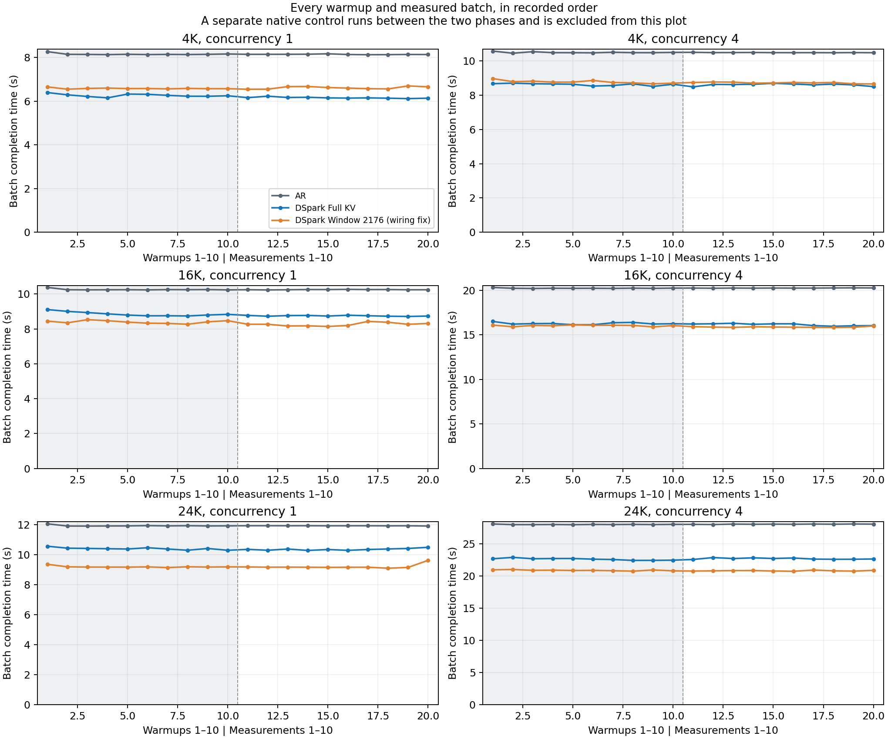
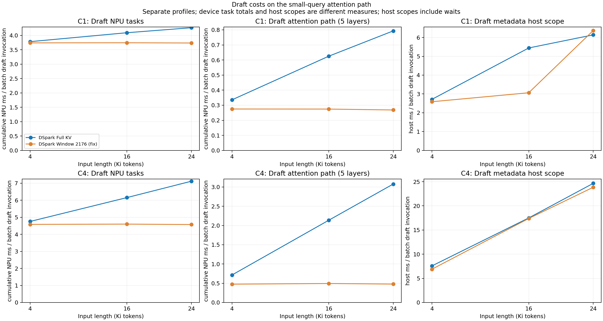
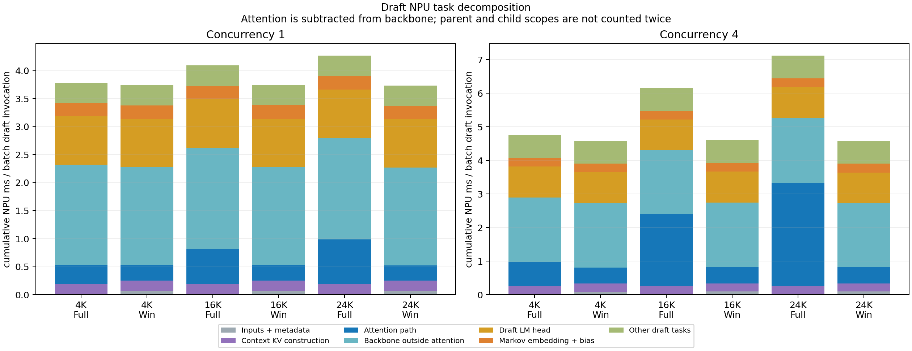
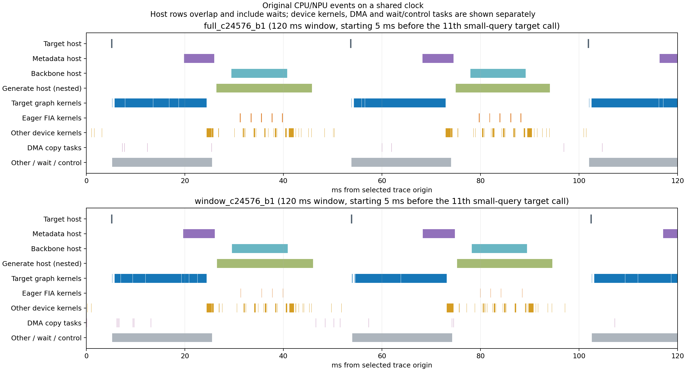
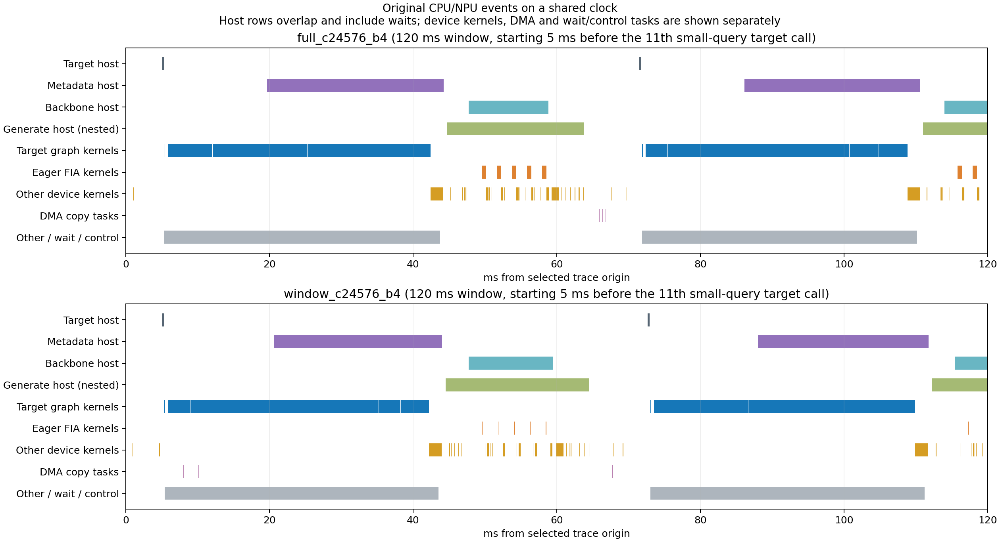

# 4K / 16K / 24K 长上下文投机解码基线

2026-10-18：正式计时、18 个配置的独立阶段 profiling、SDK 解析与证据封存均已完成。

本轮比较原生 AR、原生 DSpark Full KV，以及最小接线修正后的 Draft Window 2176。
先回答上下文增长增加了哪些成本、窗口改变了什么，再决定历史 KV 研究方向。
简历中的猜测数字未参与实验或结果拟合。

## 正式计时结果

18 个配置各预热 10 次、测量 10 次，共 180 批、450 次请求生成，实际输出均为 512 token。
并发 1 与 4 分开运行。12 个投机配置在计时之后另跑 32-token 读取审计，
共 2035 条请求/层/group 读写检查全部通过；这些同步操作未计入性能样本。

总耗时包含 prefill，排除模型加载、初始化和编译捕获。
图为十次中位数和 Q25–Q75，完整表见 [正式性能表](results/context_20261018/context_tables.md)。
下表窗口变化为 `(Window / Full − 1) × 100%`，负值表示窗口耗时较低。

| 并发 | 输入 | AR s | Full KV s | Window s | Full：AR/当前 | Window：AR/当前 | 窗口相对 Full 耗时变化 |
| --- | --- | --- | --- | --- | --- | --- | --- |
| 1 | 4K | 8.143 | 6.153 | 6.613 | 1.323× | 1.231× | +7.47% |
| 1 | 16K | 10.247 | 8.743 | 8.262 | 1.172× | 1.240× | −5.51% |
| 1 | 24K | 11.938 | 10.358 | 9.170 | 1.153× | 1.302× | −11.47% |
| 4 | 4K | 10.474 | 8.616 | 8.721 | 1.216× | 1.201× | +1.21% |
| 4 | 16K | 20.250 | 16.197 | 15.867 | 1.250× | 1.276× | −2.04% |
| 4 | 24K | 28.069 | 22.690 | 20.817 | 1.237× | 1.348× | −8.25% |

跨方法输出存在差异，因此这些是本次固定工作量下观察到的耗时比，不能统一称为已验证的无损加速。
并发 1 的三个长度中，Full KV 与 Window 各自的十次完整输出相同；
并发 4 时两种投机方法之间也存在输出差异。

## 上下文增长同时影响首 token 和生成阶段

AR 单并发的 TPOT 从 4K 的 15.420 ms 升到 24K 的 18.483 ms；
并发 4 从 18.673 ms 升到 41.685 ms。长输入增加的成本已经进入生成阶段。
单并发 Full KV 从 11.437 ms 升到 15.113 ms，Window 从 12.337 ms 升到 12.789 ms。
窗口在 4K 的回退和在长输入的收益，需要同时结合每轮成本及接受量解释。

AR 单并发的 TTFT 从 263 ms 升到 2493 ms，并发 4 从 907 ms 升到 6584 ms。
投机组没有缩短 Target 的完整 prompt prefill：24K 单并发约 2632–2637 ms，
并发 4 约 7017–7041 ms，均高于对应 AR。
原生请求语义 prefill / decode / 排队时间见 [请求级表](results/context_20261018/context_request_details.md)。
这些区间包含调度与等待，不等同于 NPU kernel 累计时间。

这里直接展示每批请求 prefill / decode 区间的中位数，再汇总十次重复；
并发 4 的请求可能分批调度，排队时间与 prefill 区间须结合请求级表一起读。

吞吐按实际输出 token / 整批完成时间计算；并发 4 为四请求合计，不能当成单请求生成速度。
四请求采用同类任务，首请求与单并发输入相同；其余请求包含不同记录代码和远/中/近距离事实。
跨长度也改变了填充内容与事实距离，因此接受量变化不能全部归因于 KV 长度。

## 接受长度与回退

单并发 Full KV 的平均接受长度从 4K 的 3.507 降至 16K 的 2.903、24K 的 2.834。
Window 对应为 3.241、3.141、3.316。4K 的窗口降低了接受量，同时总耗时上升；
16K、24K 接受量上升，总耗时下降。并发 4 的窗口也在长输入提高了接受量。

指标为 `1 + accepted draft tokens / request draft rounds`，包含 bonus token，
来源是十次测量区间的累计计数；末轮截断会与真实输出/轮略有差异。
它不是 NPU batch Draft 调用数，不能直接用完整输出的计数分摊前 64 次迭代的局部 trace。

所有轮次都保留。16K / 并发 4 Full KV 的后五次中位数比前五次低约 1.27%；
窗口约低 0.17%。窗口该配置的总耗时改善仅 2.04%，仍需后续交错顺序复测判断较小差异的稳定性。
本轮按预定十次汇总，没有删除慢值或重试到一致。
24K / 单并发 Window 的最后一次为 9.632 s，中位数为 9.170 s；
该次输出与投机计数均未变化，原因未定位，完整记录仍纳入统计。

## 输出检查和实际修正

全部 450 次请求均命中合成任务的恢复代码，但这只是局部检查。
投机组只有 16K / 单并发的 Full KV 与 Window 共 20/300 次请求输出和对应 AR 首轮完全相同。
同方法原生控制检查在 180 批中匹配 171 批；九次差异集中在 4K / 并发 4 的 Full KV 和 Window，
分别匹配 8/10 和 3/10。差异未改写为通过，所有 token 和文本变体见
[全部输出](results/context_20261018/context_outputs.md)。

本轮测量入口经历了独立核验：旧直接 engine 入口、逐 token 观察尝试和严格控制失败均保留。
最终原样调用 `LLM.generate`，保留 `FINAL_ONLY`，只在请求结束时读取已有原生统计。
TTFT 取原生 frontend 的 `first_token_latency`；TPOT 取 core 首末 token 单调时间差 / 511。
没有把墙上时钟与单调时钟混减。完整核验链见 [实际发现](context_baseline_findings.md)。

原安装版本的窗口设置会被 DSpark 分组 builder 覆盖，实际从完整表的旧页开头读取。
原生窗口独立审计 160 条读表检查失败，写入地址正确；它不能代表最近窗口基线。
最小修正版将缩窗移至每 group 的完整表确定后，修正 query 重复计数，并保留绝对写入地址。
CPU 隔离检查从 28/44 失败变为 44/44 通过，随后独立 NPU 检查及正式读取审计通过。

2176 是配置窗口，页大小为 128，实际读长受左边界对齐影响，可能为 2176–2303 token。
Target 仍读完整上下文，完整 KV 存储也保持预分配。单并发 Full 与 Window 启动分配均约 48.38 GiB，
KV 容量均为 1422 块；AR 约 48.44 GiB、1884 块。这是固定 0.8 内存预算下的启动记录，
不能解释为 Window 节省了完整 KV 常驻内存，也不是正式生成峰值。

## 阶段 profiling 与瓶颈

每配置另预热 3 次、生成原生控制 1 次，再采集一次完整的 512-token 生成。
采集覆盖前 64 个 worker 迭代，18 份合计 1152 次；包含 prefill、混合路径与部分小 query 路径。
24K / 并发 4 的每份 trace 中，6 次为 prefill、19 次为 mixed、39 次为小 query。
因此下文的每调用成本不是整个 512-token 请求的完整阶段占比。

当前 TorchNPU 的 CPU 作用域设备关联会漏掉 Target 图回放内部 kernel。
这里按实际 graph model ID 恢复图任务累计时间，核验每回放对应 36 个 FIA 记录；
全部 18 个配置通过核验，未出现未知执行模式或采集中的新图捕获。
完整数据见 [阶段表](results/context_20261018/context_profile_tables.md)、
[阶段 JSON](results/context_20261018/profile_summary.json)、
[作用域 CSV](results/context_20261018/profile_scopes.csv)。

### 长上下文与并发共同放大 Target attention 成本

以下均为小 query 图回放中的累计 NPU 任务时间，单位 ms/调用。
FIA 属于 forward 的子集，不能与 forward 相加。实际图回放数和阶段调用数见完整阶段表。

| 并发 | 输入 | AR forward / FIA | Full KV forward / FIA | Window forward / FIA |
| --- | --- | --- | --- | --- |
| 1 | 4K | 13.522 / 1.856 | 14.765 / 2.130 | 14.852 / 2.146 |
| 1 | 16K | 15.464 / 3.701 | 16.860 / 4.132 | 16.826 / 4.048 |
| 1 | 24K | 16.567 / 4.791 | 18.000 / 5.281 | 18.047 / 5.281 |
| 4 | 4K | 16.448 / 4.601 | 19.018 / 5.002 | 18.818 / 4.942 |
| 4 | 16K | 26.321 / 14.448 | 29.020 / 15.227 | 29.063 / 15.255 |
| 4 | 24K | 33.116 / 21.195 | 36.051 / 22.048 | 35.945 / 22.147 |

Full KV / 并发 4 从 4K 到 24K，Target forward 增加约 17.03 ms，FIA 增加约 17.05 ms；
其余图任务累计成本基本不变。24K 时 FIA 约占该图 forward 累计任务时间的 61%。
窗口组仍支付几乎相同的 Target 成本，因为它只修改 Draft 的读取范围。
这是长上下文、多请求下最明确的设备侧增长项。
没有采集到实际 HBM 带宽，不能据此直接宣称已经证明 memory-bound 或给出带宽利用率。

### Draft 缩窗有效，但影响的只是部分成本

| 并发 | 输入 | Full Draft 总 NPU ms | Window Draft 总 NPU ms | Full 五层 attention ms | Window 五层 attention ms |
| --- | --- | --- | --- | --- | --- |
| 1 | 4K | 3.783 | 3.740 | 0.335 | 0.275 |
| 1 | 16K | 4.093 | 3.744 | 0.625 | 0.274 |
| 1 | 24K | 4.268 | 3.736 | 0.793 | 0.268 |
| 4 | 4K | 4.757 | 4.584 | 0.714 | 0.476 |
| 4 | 16K | 6.157 | 4.601 | 2.136 | 0.493 |
| 4 | 24K | 7.118 | 4.574 | 3.076 | 0.478 |

按一次 batch Draft 调用归一化，不把并发 4 当成四个独立单请求调用。
24K / 并发 4 中，attention 累计成本下降约 84.5%，Draft 总成本下降约 35.7%；
而 Target forward 仍约 36 ms/调用。attention 的明显改善会被 Target、其他 Draft 计算和调度路径稀释。

backbone 中的 attention 已扣除一次。LM head 约为单并发 0.86 ms、并发 4 为 0.92 ms；
七次 Markov embedding+bias 的合计约为 0.24 / 0.26 ms，随上下文变化较小。
这些只覆盖对应设备任务；Markov 的 Python 循环、采样和派发代价不能用这两个作用域的 NPU 时间全部代表。

4K 单并发时，窗口仅节省约 0.061 ms 的 Draft attention，却将平均接受长度从 3.507 降至 3.241。
需要更多验证轮次，与正式计时回退 7.47% 的方向相符。
长输入中同时出现 attention 降低与接受量上升，二者共同影响最终耗时；
本轮未用局部 trace 为完整请求做精确收益分摊。

### Metadata 的大段 host 时间包含设备依赖与等待

时间线固定取第 11 次小 query Target 调用前 5 ms 开始的 120 ms，未按最好看的片段挑选。
计算 kernel、DMA 与等待/控制任务分行展示；`EVENT_WAIT`、`MODEL_EXECUTE`、`NOP` 等不会被涂成有效计算。
Native metadata host 的 24K / 并发 4 平均时长为 Full 24.66 ms、Window 23.85 ms，
与正在执行的 Target 图任务显著重叠。仅凭这个 host 数字，不能把整段都算成额外 CPU 计算。

原始 API 表也记录了 stream 同步调用，但该表包含 prefill 和 mixed 等阶段，
不能将全 trace 的同步平均值直接套给某一个 decode metadata 调用。
后续需要区分必要的数据依赖、D2H 同步、CPU 准备和可重叠工作，而非先假设 metadata 算法慢。

所有采集运行独立保存。其耗时约为对应正式中位数的 1.028–1.493 倍；
该比值同时受到预热次数、作用域标记、Profiler 和输出变化影响，不是隔离得到的 Profiler 开销。
16K / 单并发 Window 的采集耗时高约 49.3%，但正式计时更快，
说明不能拿一次 instrumented host 时间直接替代生产性能比较。
18 个采集批次中，17 个与各自原生控制输出一致，真实比较标记见
[采集运行观察](results/context_20261018/profile_runtime_observations.json)。
采集中的唯一差异发生于 AR / 4K / 并发 4，未将它重标为一致；正式 AR 十次测量仍全部匹配其控制输出。

### 基于已发现问题的下一阶段实验

| 已发现的限制 | 下一项可区分原因的实验 | 必须保留的判定条件 |
| --- | --- | --- |
| Target attention 是长上下文并发 4 的主要设备增长项 | 先用轻量计数核对完整请求的验证 batch 数及活跃请求变化，再评估减少验证轮次的收益 | 输入、K=7 与执行模式固定；不以局部 trace 估算全部 512 token |
| 4K 窗口的设备节省不足以覆盖接受量下降 | 在固定读取预算下，仅替换一页历史 KV；使用请求级缓存，并与 uniform/sink 对照 | 历史选择仅用问题和 prompt，不读答案标签；先验证真实读写地址，再测接受量与总耗时 |
| Metadata host 包含长时间设备依赖 | 对 CPU 长度镜像与同步调用做单因素、轻量计时对照，追踪实际等待依赖 | 不把等待当成 CPU 算力；保持 Target/模型计算相同并检查所有输出差异 |
| 部分 greedy 输出与 AR 不同 | 固定分叉前缀做逐步 logits / margin 对照，区分数值与执行几何因素 | 先定位原因，不将不一致重标为正确或通过 |

历史页研究尚未在本轮启用。是否继续、是否有效，依据下一阶段的真实接受量和端到端结果决定。

## 固定条件与边界

| 条件 | 本轮设置 |
| --- | --- |
| 设备 | 单逻辑设备 0，Ascend 910B2，64 GB；24 Cube / 48 Vector |
| 模型 | Qwen3-8B Target，36 层；DSpark Block-7 Draft，5 层，Markov rank 256 |
| 精度与生成 | BF16，greedy，seed 42，忽略 EOS，实际输出固定 512 token |
| 输入与并发 | 精确编码 4096 / 16384 / 24576 token；并发 1 与 4 分开 |
| 执行 | Target `FULL_DECODE_ONLY`；Draft eager；K=7；前缀缓存关闭 |
| 调度 | 实际预算 4096；物理容量 AR 4096、DSpark `4096 + 6 × concurrency`；chunked prefill 与 async scheduling 开启 |
| 模型最大长度与内存 | 32768，`gpu_memory_utilization=0.8` |
| 软件 | CANN/NNAL 9.1，torch 2.10.0+cpu，torch-npu 2.10.0.post4，Python 3.12.13 |
| vLLM 实际 commit | `568afb3a13806beb53bb2e6bd518269357b237c0`，版本字符串 `0.26.0+empty` |
| vLLM Ascend 实际 commit | `85625bd772f27a4a13bc8e548f131af5ce3ff734`，版本字符串 `0.19.1rc2.dev1398+g85625bd77` |

模型文件逐一核对 SHA-256；实际软件 commit、原始命令和源码快照随证据保存。
供应环境的 verified vLLM commit 与实际 commit 不同，驱动完整配套也有 UNKNOWN 项；
本轮结果只代表冻结的实际组合，不能写成全部官方兼容性已确认。
历史 1K 运行门槛诊断和另一设备上的组件实验均与本轮分开。

原生 logits NaN 检查未启用，`is_corrupted=false` 不代表已经执行全量 NaN 扫描。
greedy 分叉的候选原因包括 BF16 精度、批处理和验证路径差异；未采集逐步 logits/margin 对照，根因尚未证明。
官方文档也说明有限精度下不同执行路径可能改变输出，见
[vLLM 投机解码说明](https://docs.vllm.ai/en/v0.8.3/features/spec_decode.html)。

本轮只有一种合成长文档任务模板和固定输出预算，不能代替真实长文档、多任务或自然 EOS 的质量评估。
固定 K=7 的本地 DSpark 运行不等于复现 [DSpark 论文](https://arxiv.org/abs/2607.05147) 的全部机制与评测。
观察到的收益、回退和未定位的差异均作为后续研究依据。

## 原始证据与复算

[完整数值 JSON](results/context_20261018/context_summary.json)、
[CSV](results/context_20261018/context_summary.csv)、
[正式性能表](results/context_20261018/context_tables.md)、
[请求级表](results/context_20261018/context_request_details.md)、
[全部输出变体](results/context_20261018/context_outputs.md)。
[541 文件封存清单](evidence/context_20261018/manifest.json)、
[阶段表](results/context_20261018/context_profile_tables.md)、
[阶段 JSON](results/context_20261018/profile_summary.json) 保存完整定位证据。
541 个文件均通过压缩和展开 SHA-256 校验，三个终态任务均成功；
本地从 CSV 独立复算的 18 份阶段配置与服务器汇总完全一致。
另外 2353 个 SDK 原始文件保留在服务器，仓库保存其哈希目录；不将它们写成全部已下载。
无 NPU 复算与同条件重跑方法见 [复核说明](context_reproduction.md)。

相关本地回归共 71 项通过，覆盖时钟、输出标记、完整矩阵、真实 trace 文件名、
等待/拷贝分类、图归因和哈希校验；12 张 PNG 经可视核对，并导出对应 SVG。
源码与正文通过固定版本 Ruff、codespell、Markdown 等检查。完整 `format.sh ci` 已尝试，
受 actionlint 依赖下载失败及 Windows 的 `/bin/bash`、`python3`、shellcheck 限制未全部执行；
可运行项目通过，部分 Python/logger 检查另行执行通过，未宣称整仓 CI 或完整分布式模型测试通过。
原始证据、冻结源码和生成图的内部标识保持原样，另以哈希、数据合同和渲染核对检查。

凭据扫描覆盖研究目录及 639 份展开证据，9 条通用规则告警逐一核实为科学数据的 SHA-256，
未为消除告警而修改原始记录。详见 [检查汇总](results/context_20261018/qa_summary.json)、
[凭据扫描复核](results/context_20261018/credential_scan_review.json) 和
[冻结/当前观察器说明](results/context_20261018/canonical_observer_note.json)。
