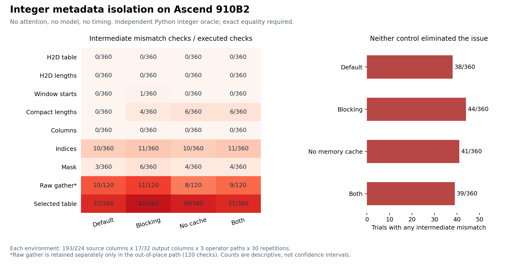
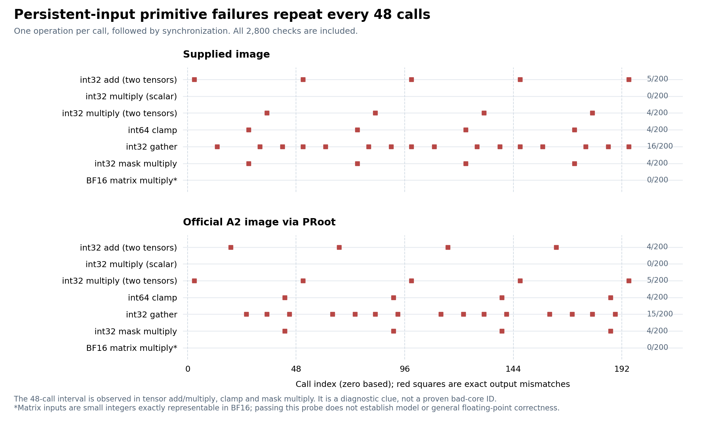

# 新环境的基础算子隔离

2026-10-18。该阶段解决的是运行环境的正确性门槛，不是历史 KV 算法的性能评估。当前结果不能用来判断稀疏 Draft 是否更快、接受率是否提高。

**复测更新：** 本文保留此前确实发生的失败及其图表。随后限时排查中，基础算子、原生 AR 与 DSpark 均出现连续通过的复测；原故障目前未再复现，根因尚未确认。最新状态见 [限时排查记录](bounded_diagnosis.md)，不能将本文旧失败率当作当前故障率。

## 为什么先检查环境

第一阶段组件数据来自 A3、CANN 9.0.0、torch-npu 2.7.1.post4。当前服务器是 910B2、驱动 25.2.1、CANN 9.1.0、torch-npu 2.10.0.post4，详见 [运行快照](evidence/server_b2/runtime_probe.json)。设备和运行库均已改变，不能把两台机器的数据合并。

先前完整模型环境还使用过官方 A3 镜像；当前供应镜像的 vLLM 源码是 `568afb3a13806beb53bb2e6bd518269357b237c0`，插件是 `85625bd772f27a4a13bc8e548f131af5ce3ff734`。插件中 [记录的已验证 vLLM 提交](evidence/server_b2/vllm-main-verified.commit) 是另一个版本。这个差异值得核查，但它不能单独解释不导入 vLLM 的整数元数据错误。

官方 [TorchNPU 配套说明](https://github.com/Ascend/pytorch/blob/master/COMPATIBILITY.en.md) 要求同时匹配 PyTorch、CANN、Python 和驱动。包版本字符串相同，也不等于具体构建和加载库完全相同。因此后续使用冻结摘要的官方 A2 镜像做交叉验证，而不直接认定某张卡或某个驱动有问题。

## 已执行的最小实验

[diagnose_npu_gather.py](diagnose_npu_gather.py) 不导入历史选择适配器、不调用 attention、不加载模型。独立 Python 整数运算构造期望值，NPU 逐元素精确比较，不使用浮点容差。

输入长度固定为 `[512, 16391, 24583, 4099]`，页长 128、局部预算 2048。每个进程执行 12 组形状/操作组合，每组重复 30 次：

- 原始块表宽度 193 / 224，比较非对齐和 32 对齐。
- 输出宽度 17 / 32，超出有效区的元素置零，源索引先夹到合法范围。
- 只做 gather、gather 后非原位乘 mask、原位乘 mask。
- 保留输入与显式命名的中间张量至同步结束，随后检查拷贝、起点、紧凑长度、列号、索引、mask 和最终块表。表达式内部仍有临时张量；随后用单算子实验进一步剥离这个因素。非原位路径还独立检查原始 gather。

| 进程配置 | 有任一中间结果不一致的次数 | 总检查次数 |
| --- | --- | --- |
| 默认 | 38 | 360 |
| `ASCEND_LAUNCH_BLOCKING=1` | 44 | 360 |
| `PYTORCH_NO_NPU_MEMORY_CACHING=1` | 41 | 360 |
| 同时启用两项 | 39 | 360 |

四组全部 1440 次检查中，完整输入块表和长度的 H2D 往返均正确，列号也均正确；后续索引、mask 或 gather 仍出现错误。例如默认进程的一次 gather 中，某行期望从 `405` 开始，实际从 `695` 开始；另一次索引应为 `0, 1, 2, ...`，却出现 `-9223372036854775808`。这些是整数内容差异，不能用精度容差解释。

对齐和两种 mask 写法都有失败，因此当前证据不支持把问题缩小到单一的非对齐尺寸或原位乘法。同步执行和禁用内存池也没有消除问题。这里每个配置只有一个进程，计数只是描述结果，不把 38 与 44 的差异解释为显著优劣。

原始结果、每个错误的元素下标和实际值、退出状态以及冻结命令见 [metadata_stages](evidence/server_b2/metadata_stages)。图表入口 [plot_metadata_diagnostics.py](plot_metadata_diagnostics.py) 校验源码 SHA-256、全部 360 个案例、运行库签名和中间检查一致性，拒绝缺项或重复样本。

另外两个独立进程显式设置算子编译模式：JIT 关闭时 34/360 次错误，开启时 57/360 次错误。这也没有形成可晋升的正确路径。原始 JSON、命令及日志均在同一证据目录。

## 官方环境交叉验证

按官方 [A2 快速开始](https://docs.vllm.ai/projects/ascend/en/v0.26.0rc1/quick_start.html) 选择 `quay.io/ascend/vllm-ascend:v0.26.0rc1`，冻结 arm64 镜像摘要为 `sha256:7265a3a08bba26b9376a4d577015ac8d459675fb3c1eec89aef6d9a19ac219d9`。6.718 GB 压缩层全部经过摘要校验，解包到研究专用目录，未覆盖供应镜像。

官方环境的 CANN 同为 9.1.0，但构建时间戳是 `20260730_231653901`，供应镜像是 `20260720_000024864`；插件由开发构建换为 `0.26.0rc1`，glibc 由 2.39 换为 2.35。硬件与宿主驱动保持相同。完整 [官方环境快照](evidence/server_b2/official_a2/runtime_probe.json) 和 [镜像清单](evidence/server_b2/official_a2/runtime_manifest.json) 已保存。

由于容器没有 mount namespace 权限，使用 PRoot 执行正确性对照。4×4 矩阵检查通过，但相同冻结脚本仍有 **48/360 次**元数据错误，见 [原始记录](evidence/server_b2/official_a2/metadata.json)。因此不能把失败只归咎于供应镜像的 vLLM 配对，也不能声称换成官方镜像已经修复。

## 固定输入单算子与 48 次周期

[diagnose_npu_primitives.py](diagnose_npu_primitives.py) 进一步使用持续存活的输入，每次只运行一个操作，紧接着同步与精确输出比较。每个操作重复 200 次。

| 操作 | 供应镜像错误次数 | 官方 A2 错误次数 |
| --- | --- | --- |
| int32 双张量加法 | 5/200 | 4/200 |
| int32 标量乘法 | 0/200 | 0/200 |
| int32 双张量乘法 | 4/200 | 5/200 |
| int64 clamp | 4/200 | 4/200 |
| int32 gather | 16/200 | 15/200 |
| int32 mask 乘法 | 4/200 | 4/200 |
| BF16 小整数矩阵乘法 | 0/200 | 0/200 |

供应镜像的加法失败序号是 `[3, 51, 99, 147, 195]`，官方环境是 `[19, 67, 115, 163]`，间隔均为 48。双张量乘法、clamp 和 mask 乘法也各自呈现 48 的间隔。gather 涉及多个重复失败位置，图中保留全部调用，不隐藏启动阶段。

额外设备属性查询返回 24 个 Cube 核、48 个 Vector 核。错误周期与 Vector 核数相符，是底层调度或执行路径的线索；没有测量物理核编号，**尚未确认某个物理核损坏**。BF16 矩阵检查只使用小整数输入，全部通过也不能证明一般浮点计算或模型正确。

采用 [进程级资源限制 API](https://www.hiascend.com/document/detail/zh/CANNCommunityEdition/82RC1alpha003/API/appdevgapi/aclcppdevg_03_1879.html) 设置 Cube/Vector 数为 1/2、4/8、23/46，分别仍有 16/1400、32/1400、33/1400 次错误。API 回读确认限制值生效，但加法等操作的 48 次周期仍在。这不是按物理核编号屏蔽的测试，不能据此判断具体核是否被排除。

[只读健康诊断](evidence/server_b2/primitive_controls/npu_health_readonly.json) 显示 Health OK、HBM 单/双比特 ECC 均为 0；`err-count` 查询不受支持。没有执行设备重置、驱动升级或修改全局配置。全部单算子与资源限制结果见 [primitive_controls](evidence/server_b2/primitive_controls)。

## 浮点向量与模型交叉检查

[diagnose_npu_vector.py](diagnose_npu_vector.py) 对 FP32 / BF16、宽度 17 / 32、加法 / 乘法 / clamp / gather 各做 200 次检查，共 3200 次。输入与期望结果都可精确表示，比较不依赖浮点容差。最终 **97 次结果错误**；每次失败都额外回读该操作的输入，全部正确，输出也没有与输入地址别名。两种精度和两种宽度都出现错误，见 [全部记录](evidence/server_b2/primitive_controls/vector_float_native.json)。该文件还保存实际查询到的 24/48 核配置。

官方 A2 镜像下额外运行未安装历史适配器的 AR：单请求、1024-token 输入、32-token 固定输出、Target eager、关闭 QK norm/RoPE 融合。初始化和权重加载完成后，生成阶段出现 `GatherV3Base<half, long>::CheckIdxValue` 的索引范围断言，随后报向量核异常 `507035`。没有产生可用 AR 结果，也不发布该次吞吐。配置与 [完整压缩日志](evidence/server_b2/official_a2/official_a2_ar_smoke_ar_1k32.log.gz) 均保留。

日志报告异常执行涉及 core 37，但断言来自非法 gather 索引，不能据此认定 37 号核硬件损坏。这与基础单算子的周期性错误共同构成进一步核查宿主驱动、固件、调度与硬件路径的依据。

HF FP32 CPU 独立参考仍处于本地草稿阶段，本轮没有发布该入口或将其用于正式正确性结论。CPU FP32 与 NPU BF16 在边界 logits 上可能产生不同 token，也不能替代同精度的 AR/投机输出一致性回归。

## 对后续实验的影响

这些结果证明当前进程中的基础元数据链路存在异常，但没有证明所有模型异常都出于同一个原因。历史 KV 原型的 CPU 正确性与当前 NPU 后端的不稳定需要分别记录。

同时继续官方环境的独立 AR 生成检查，区分模型路径与整数元数据异常。基础算子失败不直接解释每一个模型错误，也不能被一次模型冒烟通过所覆盖。[PRoot 启动器](deployment/run_proot_runtime.py) 会拦截系统调用，其端到端耗时不能作为原生性能结果发布。

基础检查稳定通过后，才恢复 AR / Full KV / Window / History 的完整模型回归，再测长上下文的接受长度、Draft 成本、Target 验证、检索准备与端到端 TPOT。
